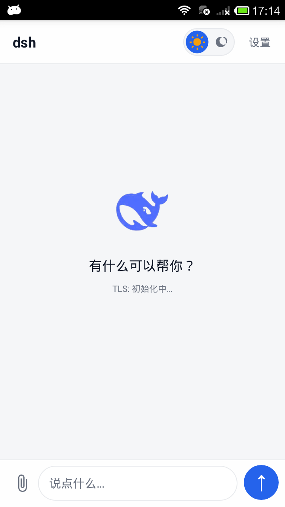
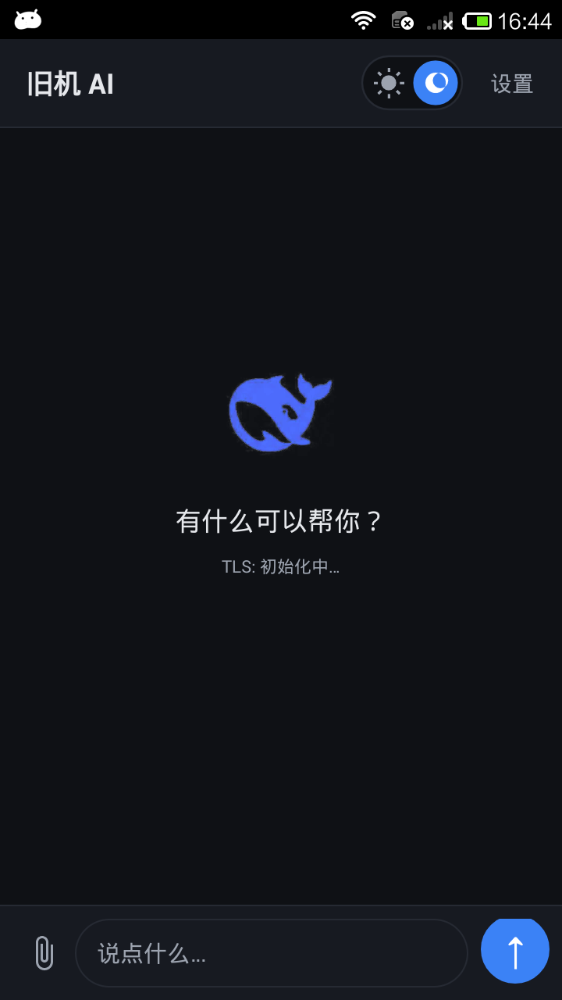
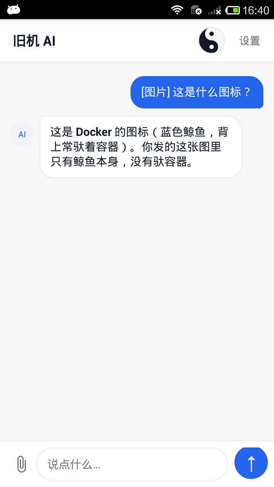
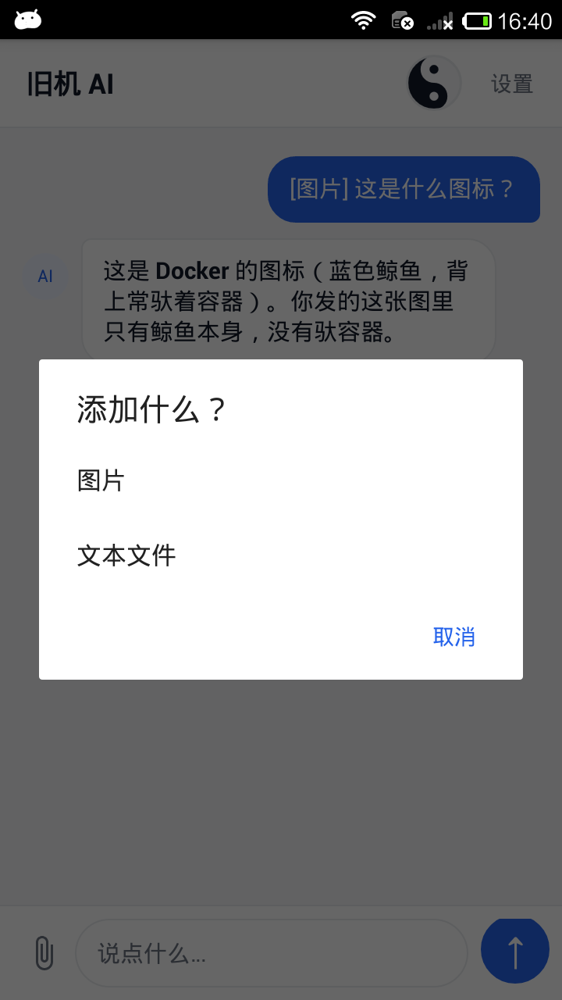
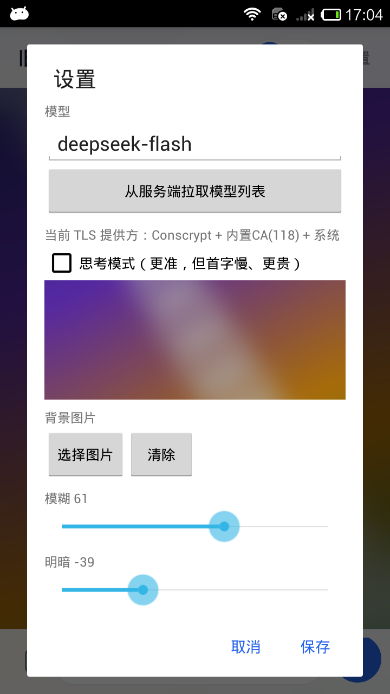
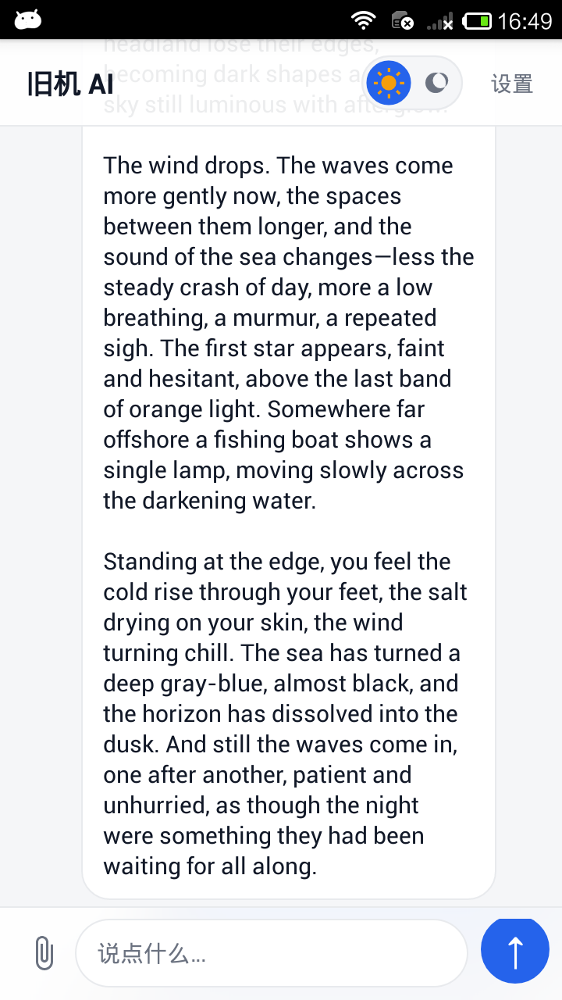
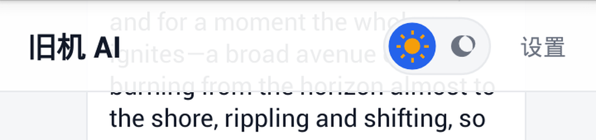
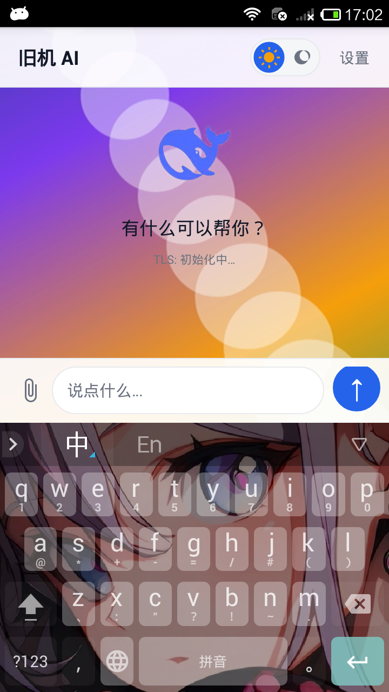
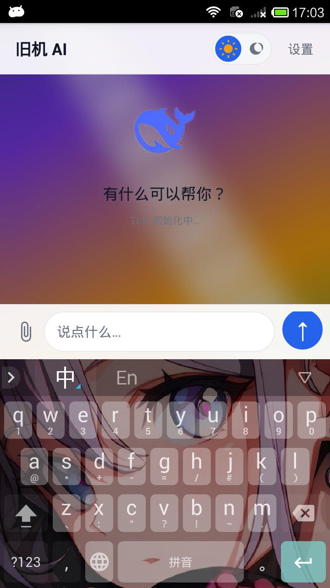

# dsh — 给 Android 4.0+ 老手机的 AI 聊天客户端

让 **Android 4.0（API 14）以上的老手机** 也能用上现代 AI 聊天客户端：流式对话、图片识别、深色模式、自定义背景，界面全部手写，不用 Compose / Material Components。


-blue)


> 纯 Kotlin + 原生 View 手写实现，无 Compose（需 API 21）、无 Material Components（需 API 19）；网络走 OkHttp 3.12 + Conscrypt，可接任何 OpenAI 格式接口。
> 已在真机 **Xiaomi 2013022（红米 1，Android 4.2.1 / API 17）** 上跑通真实 DeepSeek 接口的流式对话。

## 界面

| 浅色 | 深色 | 图片识别 |
| --- | --- | --- |
|  |  |  |

| 添加附件 | 设置 / 自定义背景 | 顶栏模糊 |
| --- | --- | --- |
|  |  |  |

界面是 Material 风格，但**没有用 Material Components 库**（`com.google.android.material` 要求 API 19+），气泡、胶囊输入框、圆形按钮、开关全部由 shape drawable 与 Canvas 绘制。

| 自绘开关（浅色） | 自绘开关（深色） | 发送键 |
| --- | --- | --- |
|  |  |  |

> 说明：部分截图摄于更名前的构建，顶栏标题仍是旧名「旧机 AI」，其余与当前版本一致。

## 特性

- **对话**：SSE 流式上屏，末尾 `▍` 光标；合并重绘约 90ms 一次，用户翻看历史时不强制滚到底
- **接口**：任意 OpenAI 兼容服务；默认 DeepSeek（`https://api.deepseek.com/v1` + `deepseek-flash`），设置页可一键拉取服务端模型列表
- **图片**：多模态 `image_url`（data URL），取图后压到长边 ≤1024px、JPEG 80 再 base64
- **文本文件**：`.txt` / `.md` / `.json` 等本地读入输入框，上限 2 万字符；PDF / Word / Excel 明确提示不支持，不发空消息
- **主题**：深色模式跟随 `AppCompatDelegate`，顶栏右侧自绘「日 / 月 + 滑块」开关，220ms 动画后切换
- **背景**：自选图片，模糊 0–100 与明暗 −100–100 双滑块，弹窗内 110dp 预览区实时生效
- **模糊栏**：顶栏 / 底栏下面是真·内容模糊（1/8 降采样 + 盒式模糊），不是贴半透明色块
- **隐私**：不登录、无统计、无广告；API Key 只存在本机私有目录，`allowBackup="false"`

## 兼容性

| 服务 / 能力 | 支持 | 说明 |
| --- | --- | --- |
| DeepSeek 官方 | ✅ 实测 | `https://api.deepseek.com/v1`，`deepseek-flash` 流式对话与图片识别 |
| 其它 OpenAI 兼容服务 | ✅ 预期可用 | 通义、智谱、Moonshot、Ollama、vLLM……只要实现 `/chat/completions` |
| 需要浏览器登录 / OAuth 的服务 | ❌ | 只支持 API Key 认证 |
| 图片识别 | 取决于模型 | 服务端需支持 `image_url` 内容块 |

| 设备 | 结果 |
| --- | --- |
| Xiaomi 2013022（Android 4.2.1 / API 17，armeabi-v7a） | ✅ 安装、启动、TLS 握手、真实流式对话 |
| Android 4.0.4 模拟器（API 15，x86） | ✅ 安装、启动、渲染、发布包运行 |
| OPPO PFFM20（Android 16 / API 36） | ✅ 安装、启动 |

## 下载安装

- **GitHub Releases**：[Latest Release](https://github.com/wangyiwei1016-cpu/dsh-Android-4/releases/latest)
- `adb install -r dsh-1.0.apk`，或用文件管理器点击安装（需允许「未知来源」）

| 项 | 值 |
| --- | --- |
| 版本 | 1.0（versionCode 1） |
| 文件 | `dsh-1.0.apk` |
| 大小 | 6,434,634 B（约 6.1 MB） |
| minSdk / targetSdk | 14 / 34 |
| ABI | armeabi-v7a / arm64-v8a / x86 / x86_64（Conscrypt native 库） |
| 签名 | v1 + v2（Android 4.0 只认 v1） |
| SHA-256 | `9CD19438E29144EAEABFE2D980A5AE022797EC1450D56C6697BE6915495F18E2` |

> 调试版与发布版使用**不同证书**，互相覆盖安装会失败（`INSTALL_PARSE_FAILED_INCONSISTENT_CERTIFICATES`）。升级正式版请始终用同一个 keystore，否则用户只能卸载重装、数据全丢。

## 使用

1. 安装后首次启动会弹出设置框，填 **接口地址 / API Key / 模型名** 三项；
2. 输入消息回车发送，回复逐字流式显示；
3. 点左下角回形针选「图片」或「文本文件」，图片会随消息一起发出去；
4. 点顶栏右侧开关切换深色模式（对话不丢）；
5. 点「设置」可改模型、开启思考模式、拉取模型列表、选自定义背景；
6. 出错时原始错误会显示在气泡里，不吞异常。

## 配置

```
接口地址  https://api.deepseek.com/v1
模型      deepseek-flash
```

也可以直接改 `shared_prefs/ai_settings.xml`。全部配置只有这三项加一个思考模式开关。

### `/v1` 和模型名是两件事

- **`/v1`** 是 **HTTP 接口协议版本**，指「OpenAI 兼容 REST 规范第 1 版」，路径形如 `/v1/chat/completions`，不会随模型升级变化；
- **模型版本**在请求体的 `model` 字段里，跟 URL 无关。

DeepSeek 当前的模型名：

| 模型名 | 实际版本 | 说明 |
| --- | --- | --- |
| `deepseek-flash` | DeepSeek-V4.1-Flash-1017 | 快、便宜，支持视觉 |
| `deepseek-v4-pro` | DeepSeek-V4-Pro-0813 | 更强，价格高，不支持视觉 |

旧的 `deepseek-v4-flash` / `deepseek-v4-flash-vision-exp` 仍被接受但已下架；`deepseek-chat` 这类老别名不要再用了。模型名以后还会变，所以设置页有「从服务端拉取模型列表」按钮（`GET {baseUrl}/models`），点选即可。

### 思考模式

`deepseek-flash` 默认开启思考模式，会先吐一大段 `reasoning_content` 再给正文——老机器上首字延迟很难受，所以本 App **默认关闭**：

```json
{"thinking": {"type": "disabled"}}
```

设置页勾选「思考模式」可打开。该字段是 DeepSeek 的扩展，**只在接口地址包含 `deepseek` 时才发送**，避免其它服务因不认识该字段而报错。

### API Key 存放

Key 只存在 App 私有目录的 `shared_prefs/ai_settings.xml`，不写进代码、不打包进 APK；`android:allowBackup="false"` 让 `adb backup` 也拖不出来。代价是换机、重装系统要重新填一次，这是故意的。

## 构建

环境：JDK **17 ~ 21**（AGP 8.7 不认 JDK 25）、Android SDK Platform 34 + Build-Tools 34.0.0、Gradle 8.13（wrapper 已带，走腾讯云镜像）。构建前设置 `JAVA_HOME` 与 `ANDROID_HOME`。

```bash
cd MyApp
./gradlew assembleDebug      # 调试包
./gradlew assembleRelease    # 正式包（需先配 keystore.properties）
```

Windows 一键脚本（构建 + 安装到唯一在线设备）：

```powershell
.\build.ps1                                  # 只构建
.\build.ps1 -Install                         # 构建并安装到在线设备
.\build.ps1 -Install -Serial emulator-5554   # 多设备时指定
```

### 正式签名

签名密钥 **不会** 提交到仓库。复制 `keystore.properties.example` 为 `keystore.properties`（放在 `MyApp/` 下，Gradle 会自动读取）：

```properties
storeFile=keystore/release.keystore
storePassword=你的证书口令
keyAlias=dsh
keyPassword=你的密钥口令
```

`keystore.properties`、`*.keystore`、`local.properties` 均已被 `.gitignore` 忽略；没有该文件时 release 构建会自动跳过签名，不影响 `assembleDebug`。

### 调试入口

```powershell
# 完整链路自检（TLS + HTTP），结果打到 logcat
adb shell am start -n com.example.myapp/.MainActivity --ez selftest true
adb logcat -d -s OldAI:*

# 流式自检
adb shell am start -n com.example.myapp/.MainActivity --ez selftest true --ez stream true

# 预填并自动发送（走完整 UI 流程）
adb shell am start -n com.example.myapp/.MainActivity --es autoSend "你好"
```

本地假服务（验证流式渲染，不消耗 key）：`python mock_sse_server.py` 监听 `0.0.0.0:8787`，接口地址改成 `http://<电脑IP>:8787/v1`。

## 技术实现

### 两个真正的拦路虎

**1. TLS 版本。** Android 4.x 的 `SSLSocket` 默认只协商 TLS 1.0/1.1，现代服务端（含所有 AI API）直接拒绝。解法：API < 21 时用 **Conscrypt**（`org.conscrypt:conscrypt-android:2.5.2`）注入支持 TLS 1.2 的 Provider，API ≥ 21 用系统自带的。这带来 native 库，所以 APK 里打包了四套 `libconscrypt_jni.so`。

**2. 根证书。** 比 TLS 更隐蔽：2013 年前后的系统证书库**没有 2015 年后才出现的根 CA**（例如 Let's Encrypt 的 ISRG Root X1），表现是：

```
javax.net.ssl.SSLHandshakeException: java.security.cert.CertPathValidatorException:
Trust anchor for certification path not found
```

解法：内置 Mozilla CA 包（`assets/cacert.pem`，118 个根证书），运行时逐块解析成 BKS 信任库，再与系统信任库**合并**（任一认可即通过），既补上新 CA 也不丢系统已有的。实现在 `Tls.kt`，启动时后台线程预热，不阻塞冷启动。

### 模糊栏

`RenderEffect` 要 API 31，`ScriptIntrinsicBlur` 在低端机上开销也不稳，所以自己实现（`Blur.kt`）：把栏底下那条内容按 **1/8 降采样**画进小位图（720×140 的条带 → 90×18），横纵各做两遍盒式模糊，再放大回屏幕靠双线性插值，观感和真高斯差别很小。滚动时节流 **120ms** 刷新。

布局上内容铺满全屏，用 `paddingTop/paddingBottom + clipToPadding="false"` 让气泡从栏底下滑过去；栏是覆盖层，模糊图作为 **背景**（`LayerDrawable`：模糊位图 + 92% 不透明蒙层），不是子 View。



### 自定义背景

选图后复制到 App 私有目录 `files/bg.jpg`（长边缩到 1600px、JPEG 88），不依赖相册权限，删了原图也不影响。模糊 0–100 在长边 360px 的缩略图上做盒式模糊再放大，拖动时防抖 150ms；明暗 −100–100 负数盖黑、正数盖白，透明度上限 215。预览区与主界面背景共用同一张处理后的位图。

| 原图（模糊 0） | 模糊 61 / 明暗 −39 |
| --- | --- |
|  |  |

### 正文渲染

Markdown 完整实现（Markwon）要求 API 16+，所以写了个极简渲染：`**粗体**` → `StyleSpan(BOLD)`、`` `行内代码` `` → 等宽、行首 `- ` → `• `。流式与最终渲染走同一个函数，避免「流式时是粗体、结束后变回星号」。

### 流式性能

老机器上最大的开销是每个 token 都 `setText` 一次，触发整条消息列表重新测量布局。现在的做法：后台线程只往 `StringBuilder` 追加，主线程按 **90ms** 节拍刷一次（约 11 帧/秒），CPU 与布局次数降一个数量级；流式期间关闭文本选中（`setTextIsSelectable` 的 TextView 布局更重），流完再打开。

压测入口：`--ez noThrottle true` 关掉节流，用 `bench_sse_server.py`（固定 200 个分片）做 A/B。注意红米 1 上测量噪声很大，只能看趋势，不能当基准数字。

### 老系统适配

- **Multidex**：minSdk < 21 用 `MultiDexApplication`，否则 AndroidX 类在 Dalvik 上找不到；
- **`View.setBackground()` 是 API 16**：发布包在 API 15 上启动即崩（`NoSuchMethodError`），改成 `ViewCompat.setBackground()`；
- **矢量图**：`vectorDrawables.useSupportLibrary = true` + `AppCompatImageView`，4.2 原生不支持 VectorDrawable；
- **没有 ripple（API 21+）、没有 elevation**：用 1dp 描边替代阴影；
- **图标**：`make_icon2.py` 从原图按**色度**抠图（按亮度算会把中蓝色的鲸鱼当成半透明，留一圈灰边），4 倍超采样后下采样出五档 PNG，另出一张透明底 `logo.png` 给空状态用——API 14 没有自适应图标。

### 目录结构

```text
.
├─ MyApp/                           Android 工程
│  ├─ app/src/main/java/com/example/myapp/
│  │  ├─ MainActivity.kt            聊天界面、气泡、设置弹窗
│  │  ├─ AiClient.kt                OkHttp + SSE 解析、多模态请求体
│  │  ├─ Tls.kt                     Conscrypt + 内置 CA + 系统 CA 合并
│  │  ├─ Blur.kt                    降采样 + 盒式模糊
│  │  ├─ ThemeToggleView.kt         自绘「日 / 月」开关
│  │  └─ Prefs.kt                   Key-Value 配置
│  ├─ app/src/main/assets/cacert.pem  Mozilla CA 包（118 根）
│  └─ app/src/main/res/             布局、shape drawable、明暗两套配色、图标
├─ docs/screenshots/                截图
├─ build.ps1                        Windows 一键构建 / 安装
├─ mock_sse_server.py               本地假 SSE 服务
├─ bench_sse_server.py              流式压测服务
├─ make_icon2.py                    图标生成脚本
└─ README.md
```

## 验证

- **真机**：Xiaomi 2013022（Android 4.2.1 / API 17）— 安装启动、TLS 握手、真实 DeepSeek 流式对话、图片识别（发内置鲸鱼 logo，模型答「这是 Docker 的图标」）、深色模式、自定义背景、顶栏模糊；
- **API 15 模拟器**：Android 4.0.4 x86 — 发布包安装、启动、渲染通过（这一轮抓出了 `View.setBackground` 的 `NoSuchMethodError`）；
- **Android 16**：OPPO PFFM20 — 安装、启动、对话正常；
- **Lint**：`lintRelease` 0 error（29 条 warning 均为排版类）。

## 已知限制

- **对话不持久化**：进程被杀就丢，没接数据库；老机器内存小，建议后续加 SQLite 存历史
- **单会话**：没有会话列表，也没有多轮管理
- **不支持 PDF / Word / Excel**：API 14 上没有靠谱的本地解析库，选中会明确提示
- **无语音输入**、无 TTS
- **系统提示词写死在代码里**，暂未做成设置项
- **targetSdk 34**：仅为满足现代工具链，旧机分发不受影响

## 踩过的坑

- **PowerShell 往设备里写 shared_prefs 时 `-Encoding utf8` 会带 BOM**，SharedPreferences 解析失败后整份回退成默认值，表现为 API Key 凭空消失；要用 `UTF8Encoding($false)`
- **发送键圆形被切掉一块**：父容器默认 `clipChildren="true"`，圆形背景上下各被裁 2px；给底栏和输入行加 `android:clipChildren="false"` 后恢复（实测 88×88，正圆）
- **模糊图做成栏里的 `ImageView`（`match_parent`）会撑满屏幕**：`match_parent` 子 View 在 `wrap_content` 容器里被量成整屏高，改成背景 `LayerDrawable` 才解决
- **`Bitmap.createScaledBitmap()` 返回不可变位图**，直接 `setPixels()` 抛 `IllegalStateException`，必须先 `copy(ARGB_8888, true)`——这个 bug 让背景模糊静默失败，界面上只看到纯色
- **透明 PNG 转 JPEG 会变白底**，拿透明底 logo 当背景测试会一片白
- `services.gradle.org` 302 到墙外 CDN，wrapper 指向腾讯云镜像；改 `AndroidManifest.xml` 后 Gradle 显示 UP-TO-DATE，要加 `--rerun-tasks`
- 红米 1 的 MIUI：`/sdcard` 对 shell 不可写，截图写 `/data/local/tmp`；老机器 `adb input` 丢事件严重，UI 验证改用 intent 触发的自检

## License

[MIT](LICENSE)

本项目为独立实现，与 DeepSeek 官方无隶属关系；DeepSeek 名称与接口规范版权归其作者所有。

---

## English summary

**dsh** is an AI chat client for **Android 4.0 (API 14) and above** — built for phones from around 2013 that no modern app supports anymore. Streaming chat, image understanding, dark mode and custom backgrounds, written in Kotlin with hand-rolled Views: no Compose (API 21+), no Material Components (API 19+).

- TLS 1.2 on Android 4.x via Conscrypt, plus a bundled Mozilla CA store (118 roots) merged with the system trust store — old devices cannot validate Let's Encrypt-era certificates.
- Works with any OpenAI-compatible `/chat/completions` endpoint; DeepSeek is the default.
- Verified on Xiaomi 2013022 (Android 4.2.1 / API 17) against the real DeepSeek API, on an Android 4.0.4 x86 emulator, and on Android 16.

Install `dsh-1.0.apk` from the [latest release](https://github.com/wangyiwei1016-cpu/dsh-Android-4/releases/latest) (`adb install -r`). Build with `./gradlew assembleDebug` in `MyApp/`, or `./build.ps1 -Install` on Windows.
